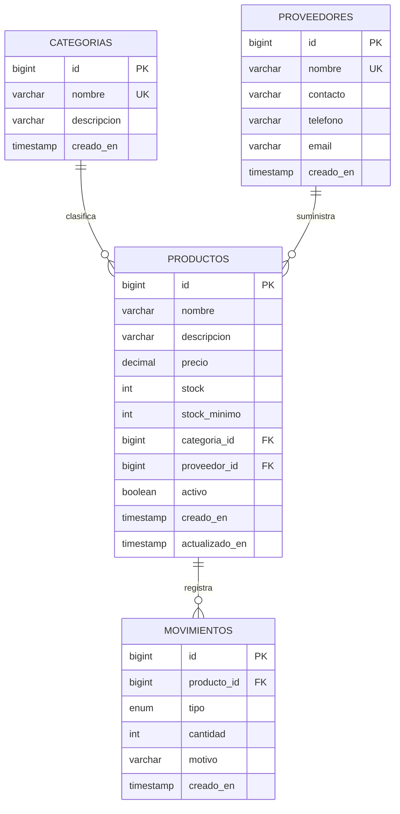

# Modelo entidad-relación

## Reglas del modelo

- Un producto pertenece a una categoría.
- Un producto puede tener un proveedor; si el proveedor se elimina, el producto queda sin proveedor.
- Cada movimiento pertenece a un producto y conserva el historial de entradas, salidas y ajustes.
- El stock se modifica mediante un trigger, no directamente desde la aplicación.
- Los productos inactivos se conservan para no perder el historial.
